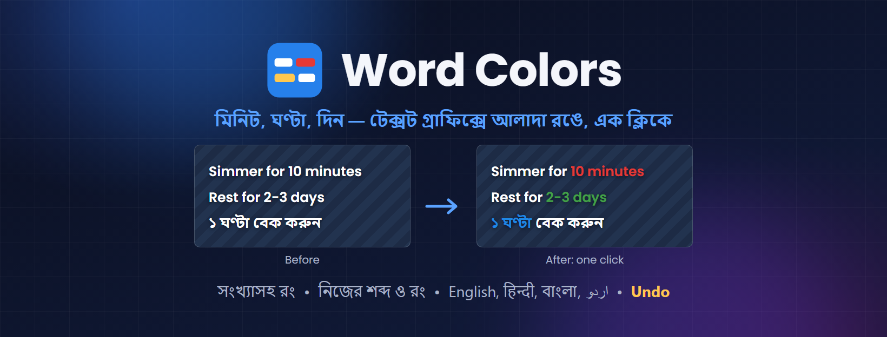

# Word Colors for Adobe Premiere Pro

**টেক্সট গ্রাফিক্সে "10 minutes", "2 days", "৩ ঘণ্টা" এর মতো সময়ের শব্দগুলো সংখ্যাসহ এক ক্লিকে আলাদা রঙে। বাকি লেখার ফন্ট, সাইজ, রং যেমন ছিল তেমনই থাকে।**

## ⬇️ ডাউনলোড / Download

### [Word-Colors.zip — সর্বশেষ ভার্সন (latest version)](https://github.com/ocpabdurrahim/word-colors/releases/latest/download/Word-Colors.zip)

> শুধু উপরের লিংক থেকে ডাউনলোড করুন। "Source code" ফাইলগুলো প্লাগইন নয়।
> Download only the link above — the "Source code" files on the releases page are not the plugin.

---

## বাংলা

রেসিপি, টিউটোরিয়াল বা যেকোনো ভিডিওর টেক্সটে সময়টা (১০ মিনিট, ২ ঘণ্টা, ৩ দিন) আলাদা রঙে দেখালে চোখে পড়ে, কিন্তু প্রতিটা গ্রাফিকে হাতে শব্দ সিলেক্ট করে রং বদলানো সময় নেয়। Word Colors পুরো সিকোয়েন্সের সব টেক্সট গ্রাফিক খুঁজে এক ক্লিকে সেটা করে দেয়।

**যা করে**
- সেকেন্ড, মিনিট, ঘণ্টা, দিন, সপ্তাহ: প্রতিটার নিজের রং; ইংরেজি, হিন্দি, বাংলা আর উর্দু শব্দ আগে থেকেই দেওয়া
- সামনের সংখ্যাসহ রং: 10 minutes, 2-3 days, 1½ hours, 10 to 15 minutes, 40 से 50 सेकंड
- নিজের শব্দ আর রং যোগ করা যায় ("+ Add a color"), শব্দ পুরোটা মিললে তবেই রং হয়
- রং করার আগে তালিকায় দেখায় কোন গ্রাফিকে কোন শব্দ রং হবে; চাইলে যেকোনোটা বাদ দেওয়া যায়
- রং সরাসরি এই প্রজেক্টেই বসে (প্রজেক্ট এক মুহূর্তের জন্য বন্ধ হয়ে আবার খোলে), অথবা চাইলে "(colored)" নামে একটা কপিতে
- **Undo colors**: শুধু রংগুলো তুলে নেয়, পরে করা বাকি সব কাজ থেকে যায়; প্রতিবার রং করার আগে প্রজেক্টের একটা ব্যাকআপও রাখা হয়

**যা লাগবে:** Windows • Adobe Premiere Pro 2023 বা নতুন। কোনো API key বা ইন্টারনেট লাগে না।

**ইনস্টল**
1. zip ফাইলে রাইট ক্লিক > **Extract All** > Extract।
2. Premiere Pro বন্ধ করুন।
3. Extract করা ফোল্ডারে **Install.bat**-এ ডাবল ক্লিক, **Y** চাপুন।
   "Windows protected your PC" দেখালে: **More info > Run anyway**।
4. Premiere Pro-তে: **Window > Extensions > Word Colors**।

**ব্যবহার:** প্রজেক্ট খুলুন (একবার সেভ করা থাকতে হবে), প্যানেলে শব্দ আর রং দেখে নিন, **Find words** তারপর **Color them**। শুধু Type tool দিয়ে বানানো টেক্সট গ্রাফিক রং হয়; .mogrt আর ক্যাপশন নয়।

---

## English

Showing the time in a step ("10 minutes", "2 hours", "3 days") in its own color makes it easy to spot, but selecting the words and changing their color by hand in every graphic takes ages. Word Colors finds them in all the text graphics of a sequence and colors them in one click.

**What it does**
- Seconds, minutes, hours, days, weeks: each with its own color; English, Hindi, Bangla and Urdu words are already in the lists
- Colors the number in front too: 10 minutes, 2-3 days, 1½ hours, 10 to 15 minutes, 40 से 50 सेकंड
- Add your own words and colors ("+ Add a color"); only whole words match
- Before coloring, a list shows which words in which graphics will change; untick any you want to skip
- The colors go straight into the open project (it closes and opens again for a moment), or into a copy named "(colored)" if you prefer
- **Undo colors** takes just the colors out again and keeps everything you did since; a backup of the project is also kept before each coloring

**Needs:** Windows • Adobe Premiere Pro 2023 or newer. No API key, no internet.

**Install**
1. Right-click the zip > **Extract All** > Extract.
2. Close Premiere Pro.
3. In the extracted folder, double-click **Install.bat** and press **Y**.
   If Windows says "Windows protected your PC": **More info > Run anyway**.
4. In Premiere Pro: **Window > Extensions > Word Colors**.

**Use:** open your project (saved at least once), check the words and colors in the panel, click **Find words**, then **Color them**. Only text graphics made with the Type tool are colored; .mogrt templates and captions are not.

---

**More Premiere Pro plugins:** [Graphics Translator](https://github.com/ocpabdurrahim/graphics-translator) (translates text graphics) • [Graphics Voice-over](https://github.com/ocpabdurrahim/graphics-voice-over) (AI voice-over from the captions) • [Project Sync](https://github.com/ocpabdurrahim/project-sync) (keeps bins and folders in sync) • [Align & Distribute](https://github.com/ocpabdurrahim/align-and-distribute) (lines up text graphics)
